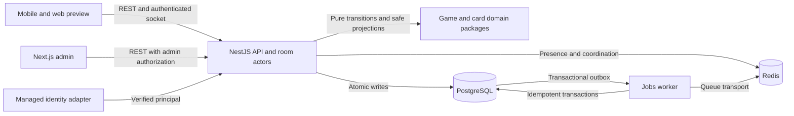

# Architecture baseline — B003

28 October 2026. Engineering baseline for incremental implementation. Product authority remains `MASTER_SPEC.md` and its v1.1 exploration/press additions; unresolved rules stay in `DECISIONS.md`. Only the B001 shells and health contract currently execute. The boundaries and protocols below describe the target, not implemented services.

## Deployment and ownership

Start with one modular NestJS API process and a separate Node worker, sharing PostgreSQL as the durable record. Room actors are logical per-room serialized command processors within the server, not a microservice fleet. Redis supports queues, presence and coordination; loss of Redis must not erase ownership, balances, committed commands or match outcomes. Horizontal room placement requires durable single-writer fencing before scale-out in B018/B050.

| Context               | Authoritative owner and durable data                                                              | Permitted integration / owning tickets                                                                                       |
| --------------------- | ------------------------------------------------------------------------------------------------- | ---------------------------------------------------------------------------------------------------------------------------- |
| Identity and access   | API identity module: internal user, external identity bindings, profile, consent and roles        | Managed authentication adapter; B004–B005, B045/B051. Clients cannot choose actor identity.                                  |
| Catalog               | API catalog: face, series, template, asset rights, publication and capped edition supply          | Public published DTOs, admin publication; B006/B044.                                                                         |
| Collection            | API collection: instance, current ownership, append-only provenance, loadout                      | Authorized queries and transaction services; B007–B011.                                                                      |
| Evolution             | API evolution: fusion lineage, functional screen inventory, press recipe snapshots/jobs           | Collection and economy transaction ports; B032–B033, B066–B070.                                                              |
| Games and matchmaking | API room actors: seats, immutable hand loadout/rules snapshots, commands, events and results      | Pure engines and server RNG; B012–B031. Redis is coordination only.                                                          |
| Economy               | API economy: three wallet balances, immutable ledger, reward source keys                          | Atomic typed credit/debit operations; B022/B038/B060. No generic currency conversion operation.                              |
| Commerce and packs    | API commerce: platform transactions, entitlements, catalog/pool versions, immutable openings      | Verified platform adapters and economy/collection transactions; B039–B041/B062–B065.                                         |
| Activity              | API ingestion and reconciliation: canonical accepted intervals and independent reward allocations | Native consent adapters, accessibility quest evidence; B034–B035/B061/B071. Source upload is evidence, never trusted totals. |
| Explore               | API exploration: published safe drops/trails, ordered sessions, verified claims                   | Foreground location and licensed map/data adapters; B072–B079. Precise evidence is temporary.                                |
| Progress and events   | API progress/events: achievement progress, seasons, tournaments and settlements                   | Committed game/activity events, deduped grants; B036–B037/B042–B043.                                                         |
| Safety and operations | API/admin: moderation, audit, feature flags, privacy/export/deletion, reconciliation              | Scoped administrator commands and workers; B045–B046/B049–B053/B079–B081.                                                    |

These are module ownership boundaries, not permission for independent modules to mutate each other's tables. Cross-context atomic operations run in one server-owned transaction through explicit services. Background consumers receive minimal event references and recheck authorization/eligibility where needed.

## Package dependency rules

| Package       | Allowed dependencies                                      | Responsibilities                                                                                                                           |
| ------------- | --------------------------------------------------------- | ------------------------------------------------------------------------------------------------------------------------------------------ |
| `game-core`   | Pure TypeScript only                                      | Rank/suit/face/deck primitives, deterministic shuffle algorithm accepting injected bounded integers, common reducer/projection interfaces. |
| `game-poker`  | `game-core`, pure card-domain value snapshots when needed | Classic evaluation, poker transitions and separate versioned Evolved scoring. No inventory queries.                                        |
| `game-spades` | `game-core`                                               | Bids, legal tricks, team scoring. No dependency on poker evaluation or rarity to decide a trick.                                           |
| `card-domain` | Pure TypeScript and `game-core` face values               | Instance/loadout eligibility, fusion/press transition validation and versioned snapshots. No database transaction implementation.          |
| `contracts`   | Zod and transport-safe value types                        | Public request/response/event schemas and inferred types; never export server deck/seed/private event schemas.                             |
| `ui`          | Presentation dependencies as introduced                   | Display tokens/components; no authorization, authoritative balance or outcome calculation.                                                 |

Server adapters may import pure packages; pure packages may not import API/jobs/UI, Node RNG, network or database clients. Socket/HTTP DTOs convert to domain commands after schema validation and authorization. A shared wire contract is not the internal game-state type.

The reusable engine seam follows MASTER_SPEC §9: `kind`, `version`, `validate`, `reduce`, `projectForPlayer`, `isTerminal`. Inputs include immutable state and declarative commands; transitions return state plus events without I/O or wall-clock reads. Deadlines enter as explicit server commands. Implement the seam when its first consumer lands rather than exporting speculative interfaces now.

`game-core` owns a canonical 52-face deck, not a collector's inventory. B014 implements and tests Fisher–Yates with a server-owned CSPRNG integer adapter, bounded uniform integer selection and deterministic test input; B027 reuses it. No modulo-biased byte selection or client-selected seeds. Each poker hand uses one 52-face shuffle; instance appearance is resolved after face selection. Evolved bonuses read only eligible included owned hole-card snapshots, never paid skins or board cards. Active match versions never change under inventory updates.

## Durability and failure semantics

PostgreSQL commits state changes, append-only events, immutable outcome and outbox entry together. Publish after commit; workers retry with durable source keys. Do not promise exactly-once transport: repeated delivery is normal and effects must be idempotent. A room acknowledgment follows durable accepted-command storage. Recovery replays only through the committed version; uniqueness on room sequence/command ID and a fenced owner prevent forks. B018 owns actor recovery and failover tests.

Use deterministic lock ordering, state-version checks and bounded retries for serialization/deadlock conflicts. Do not invoke billing, push, identity providers or a map vendor while holding a database transaction. B004 supplies the transaction and migration conventions; feature tickets implement their actual cross-row invariants and concurrency tests.

| Invariant        | Required persistence proof when implemented                                                                                                                               |
| ---------------- | ------------------------------------------------------------------------------------------------------------------------------------------------------------------------- |
| Five-card fusion | Lock five eligible instances in stable order; consume exactly five, create one child and five lineage edges in one commit.                                                |
| Press completion | Lock job/card/screen/ink; apply the approved recipe once to the same instance; consume supplies and append history atomically. Lock/cancel details remain R-08 pending.   |
| Activity         | Reconcile source overlap/corrections first, then dedupe independent Trail Credit and ONE press allocation keys. R-09 defines the trust/reconciliation policy before B061. |
| Pack/settlement  | Persist draw or match result and version with debit/grants once; retry returns original outcome rather than rerolling.                                                    |
| Wallet           | Separate currency identity, integer units, nonnegative balance, version and immutable signed journal entries; no client balance assignments.                              |

## Data and trust boundaries

Keep internal user UUID separate from provider `(issuer, subject)`; keep `instanceId`, face identity, template/series, earned playStyleFamily and paid display skin distinct. API names use `instanceId`; draft `CardInstance.id` is a storage mapping, not a second identity. Catalog versions, `rulesetVersion`, recipe/pool/economy versions and mutable `stateVersion` have distinct meanings.

Never put bearer tokens in URLs, Redis broadcasts containing private cards, raw health/location evidence in logs, or production credentials in builds. Structured operational logs use server request/trace ID, operation, safe error code, duration and outcome; sensitive authorization evidence stays in access-controlled audit storage. Aggregate metrics measure room conflicts/latency, duplicate grants, ledger reconciliation, ingestion rejection and evidence purge lag. Retention durations and incident thresholds require documented owner review before the affected feature ships.

Raw route traces need a short-lived private verification store with enforced expiry/deletion; durable trail records keep only coarse session/claim summaries. Step-only press use requires no GPS. A curated public route's published geometry is catalog data and is distinct from a person's recorded route. No map/provider, health, billing or location integration is added by B003.

See [protocol](PROTOCOL.md), [environments/runbook](ENVIRONMENTS.md), [ADR](adr/0001-platform-boundaries.md), and [requirement coverage](REQUIREMENT_COVERAGE.md). Draft Prisma remains nonexecutable until B004; do not instantiate all future models now.
