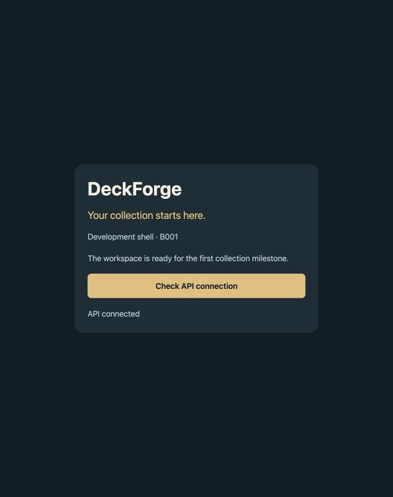

# B001 — Monorepo Scaffold completion report

Date: 27 October 2026. Status: **implemented and locally validated; CI acceptance pending B002**.

## Delivered

Strict TypeScript/pnpm/Turborepo workspace with Expo mobile, Next.js admin, NestJS API, jobs lifecycle shell and six shared packages. Game/domain packages remain empty boundaries with lint restrictions; no gameplay, payments, blockchain, health or location behavior was added. The mobile connection button calls the rate-limited public API health endpoint and validates the response using the shared Zod contract. Admin contains no privileged actions or user data.

Pinned runtime/dependencies, frozen lockfile, ESLint/Prettier/Vitest, environment templates, non-overwriting setup, loopback-bound Docker services and setup instructions are included. `prisma/README.md` reserves database ownership for B004; no persisted application feature or migration was introduced.

## Validation actually performed

| Command / action                                                                                                                                                                         | Result                                                                                                                                                      |
| ---------------------------------------------------------------------------------------------------------------------------------------------------------------------------------------- | ----------------------------------------------------------------------------------------------------------------------------------------------------------- |
| Node/pnpm versions; registry `pnpm view` compatibility queries                                                                                                                           | Node 22.22.0, pnpm 10.30.2; pinned SDK/framework versions selected.                                                                                         |
| `pnpm install`                                                                                                                                                                           | Passed with approved registry access. Initial sandbox-only attempt could not resolve npm; stopped before retrying with network access.                      |
| `pnpm setup` (initial attempt)                                                                                                                                                           | Invoked pnpm's built-in command and failed writing shell config. Replaced the project command with `pnpm setup:local`; no shell setup escalation performed. |
| `pnpm setup:local` twice in a fresh copy                                                                                                                                                 | First created five ignored environment files; second preserved all five.                                                                                    |
| `pnpm format`, `pnpm check`                                                                                                                                                              | Passed: formatting, zero-warning lint, strict types across 10 packages plus test sources, and all 9 tests.                                                  |
| `pnpm build`                                                                                                                                                                             | All 10 package builds passed: six libraries, API/jobs TypeScript, Next production pages and Expo web export.                                                |
| `pnpm --filter @deckforge/mobile exec expo install --check`                                                                                                                              | Initially identified react-native-web mismatch; corrected to 0.21.4 and reran successfully.                                                                 |
| Fresh source copy, excluding dependencies, build caches and `.env` files: `pnpm install --frozen-lockfile --offline && pnpm setup:local && pnpm setup:local && pnpm check && pnpm build` | Passed using the downloaded package store and lockfile, with no existing node_modules or generated application outputs. This is local reproduction, not CI. |
| `pnpm --filter @deckforge/mobile exec expo export --platform ios --platform android --output-dir dist-native`                                                                            | Passed for both platforms (Hermes bundles). Temporary generated export removed afterward. Not native compilation or physical-device testing.                |
| `pnpm dev`                                                                                                                                                                               | All four processes launched; API registered `/health`, jobs emitted readiness/heartbeat, admin and Expo served locally.                                     |
| Browser at `http://localhost:8081`, then **Check API connection**                                                                                                                        | Visible “API connected”; evidence below.                                                                                                                    |
| Browser at `http://localhost:3000`                                                                                                                                                       | Admin page rendered correctly.                                                                                                                              |
| `open -a Docker`                                                                                                                                                                         | Started installed Docker Desktop after initial daemon-unavailable result.                                                                                   |
| `docker compose config --quiet`, `docker compose up -d --wait`, `docker compose ps`                                                                                                      | Passed; both local containers healthy.                                                                                                                      |
| `docker compose exec -T postgres pg_isready -U deckforge -d deckforge`                                                                                                                   | Accepting connections.                                                                                                                                      |
| `docker compose exec -T redis redis-cli ping`                                                                                                                                            | PONG.                                                                                                                                                       |

The nine tests cover the public response schema, rejection of private/invalid response fields, actual HTTP liveness, exact browser-origin handling, absence of a business route, loopback defaults, three invalid ports and invalid CORS configuration. No financial, inventory, RNG or game rules exist to test in this ticket.

Framework output included harmless NO_COLOR/FORCE_COLOR warnings. The initial deprecated ESLint major was replaced with supported ESLint 10. Vitest config was renamed to `.mts` to resolve its module-format warning. Generated Next environment typings are ignored and regenerated by `next typegen` before typechecking.



## Remaining acceptance and risks

- B002 must run these checks in actual CI and configure remote required checks. No GitHub repository, push or deployment was requested or performed.
- Installed Xcode 26.3 is below Expo SDK 58's documented 26.4+ native iOS requirement. Native compilation, Android toolchain/device setup and physical-device behavior are not validated.
- Prisma validation, migrations, seeds, application DB integration and rollback belong to B004. The incomplete draft `architecture/schema.prisma` was not executed.
- The public health endpoint is liveness only. Authentication and authorization arrive in B005 before business/private endpoints; the scaffold is not production-ready.
- Shared package source changes require `pnpm build:packages` or restarting `pnpm dev`. Expo Router, queues and UI libraries will be added when their first actual feature needs them.
- Local example credentials are intentionally non-secret and must never be reused in staging/production. `EXPO_PUBLIC_*` values are public bundle configuration.

## Launch instructions

From `/Users/bobbyjohnson/Documents/Codex/DeckForge/deckforge` with Node 22.22.0 and pnpm 10.30.2:

```bash
pnpm install --frozen-lockfile
pnpm setup:local
pnpm dev
```

Open <http://localhost:8081> for the mobile web shell and <http://localhost:3000> for admin. The API is <http://localhost:3001/health>. Click **Check API connection** in the app. Stop with Ctrl+C. To launch only mobile web and API, use `pnpm dev:api` and `pnpm dev:web` in separate terminals.

Optional database services: start Docker Desktop, run `pnpm infra:up`; stop with `pnpm infra:down` (retains the database volume). See [README](../README.md) for native commands and device/LAN URLs.

## Files changed

The complete new/modified file inventory follows. Because this folder had no Git repository, the initial commit also imports the existing planning documents; imported originals are listed separately and are not new B001 product work.

New or modified by B001:

- `.env.example`
- `.gitignore`
- `.node-version`
- `.npmrc`
- `.nvmrc`
- `.prettierignore`
- `.prettierrc.json`
- `README.md`
- `apps/admin/.env.example`
- `apps/admin/app/layout.tsx`
- `apps/admin/app/page.tsx`
- `apps/admin/next.config.ts`
- `apps/admin/package.json`
- `apps/admin/tsconfig.json`
- `apps/mobile/.env.example`
- `apps/mobile/App.tsx`
- `apps/mobile/app.json`
- `apps/mobile/index.ts`
- `apps/mobile/package.json`
- `apps/mobile/tsconfig.json`
- `backlog/STATUS.md`
- `compose.yaml`
- `docs/B001_REPORT.md`
- `docs/DECISIONS.md`
- `docs/evidence/b001-mobile-web.png`
- `eslint.config.mjs`
- `package.json`
- `packages/card-domain/package.json`
- `packages/card-domain/src/index.ts`
- `packages/card-domain/tsconfig.json`
- `packages/contracts/package.json`
- `packages/contracts/src/index.test.ts`
- `packages/contracts/src/index.ts`
- `packages/contracts/tsconfig.json`
- `packages/game-core/package.json`
- `packages/game-core/src/index.ts`
- `packages/game-core/tsconfig.json`
- `packages/game-poker/package.json`
- `packages/game-poker/src/index.ts`
- `packages/game-poker/tsconfig.json`
- `packages/game-spades/package.json`
- `packages/game-spades/src/index.ts`
- `packages/game-spades/tsconfig.json`
- `packages/ui/package.json`
- `packages/ui/src/index.ts`
- `packages/ui/tsconfig.json`
- `pnpm-lock.yaml`
- `pnpm-workspace.yaml`
- `prisma/README.md`
- `scripts/setup.mjs`
- `services/api/.env.example`
- `services/api/package.json`
- `services/api/src/app.test.ts`
- `services/api/src/app.ts`
- `services/api/src/config.ts`
- `services/api/src/main.ts`
- `services/api/tsconfig.json`
- `services/jobs/.env.example`
- `services/jobs/package.json`
- `services/jobs/src/main.ts`
- `services/jobs/tsconfig.json`
- `tsconfig.base.json`
- `tsconfig.tests.json`
- `turbo.json`
- `vitest.config.mts`

Existing baseline imported unchanged into the initial repository:

- `AGENTS.md`
- `MASTER_SPEC.md`
- `architecture/API_CONTRACT.yaml`
- `architecture/schema.prisma`
- `backlog/BUILD_BACKLOG.csv`
- `backlog/SPRINT_PLAN.md`
- `docs/DEVELOPMENT_PLAN.md`
- `docs/EXPLORATION_AND_PRESS.md`
- `legal/LAUNCH_GATES.md`
- `prompts/REVIEW_PROMPTS.md`
- `prompts/START_HERE.md`
- `tests/ACCEPTANCE_MATRIX.md`

Git validation: environment files, dependency directories and generated outputs are ignored. Existing Git author configuration is used; no credentials or remote are configured by this ticket. The dev processes and containers used for verification were stopped afterward; the local PostgreSQL volume is retained.

Additional final checks: `pnpm check` passed after documentation and UI cleanup (9/9 tests); a direct `node dist/main.js` jobs process exited with code 0 on SIGTERM. The development supervisor printed force-kill notices during aggregate Ctrl+C shutdown; a subsequent check confirmed ports 3000, 3001 and 8081 closed. `docker compose down` removed the test containers/network and retained the PostgreSQL volume. `git init -b main` created the repository. Staging is checked for whitespace errors in B001 files and for accidentally included environment files/generated directories before committing.
