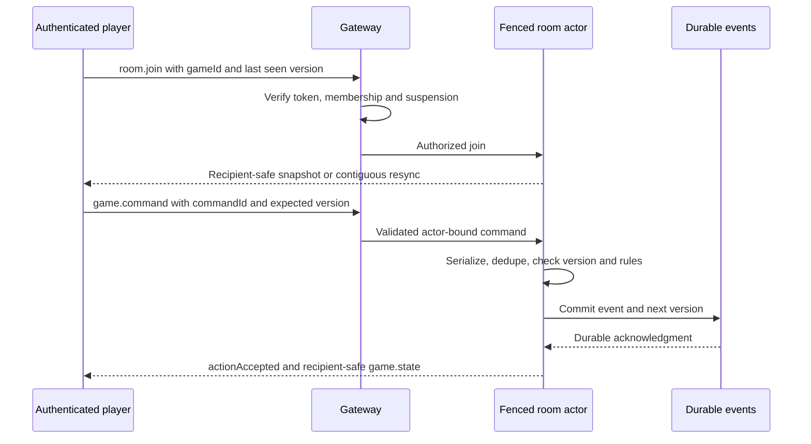

# API, room and transaction contracts — B003

28 October 2026. Only `GET /health` exists today. All `/v1` and room contracts below are design constraints for their owning tickets, not enabled handlers. The draft [OpenAPI](../architecture/API_CONTRACT.yaml) distinguishes planned operations from implemented health. Complete strict schemas, limits, auth and negative tests must land with each handler.

## HTTP conventions

Use HTTPS outside loopback development. All business requests/responses are JSON with explicit schemas and unknown-field rejection for command objects. Transport validation precedes authorization-dependent domain execution; every private resource lookup is scoped to the verified internal actor. `owner=me` is a convenience filter, never a way to select another owner. Anonymous managed identities are authenticated guest principals with explicit capabilities; public means no token required.

| Concern      | Convention                                                                                                                                                                                                                                                                                                                 |
| ------------ | -------------------------------------------------------------------------------------------------------------------------------------------------------------------------------------------------------------------------------------------------------------------------------------------------------------------------- |
| IDs and time | Opaque UUID strings for durable entities; canonical face IDs such as `Q-H` are not UUIDs. UTC RFC3339 timestamps; server time controls deadlines. Client timestamps are evidence only.                                                                                                                                     |
| Versions     | `stateVersion` is a nonnegative safe integer for optimistic concurrency. `rulesetVersion` and recipe/pool/economy versions identify immutable definitions, not counters clients may advance.                                                                                                                               |
| Amounts      | Wire wallet/ledger units are base-10 integer strings to preserve PostgreSQL BigInt precision. No floats, arbitrary currency strings or client-supplied resulting balances. Game engine chips use bounded integer ranges validated before arithmetic.                                                                       |
| Lists        | Opaque cursor and bounded `limit`, stable ordering, no offset through mutable ownership. Exact per-route maxima are specified and tested by its ticket.                                                                                                                                                                    |
| Success      | Direct typed resource/result DTOs, not internal ORM entities. Mutation response includes resulting entity versions and operation identifier as relevant.                                                                                                                                                                   |
| Errors       | Planned `{ error: { code, message, requestId } }`, with server-generated opaque requestId. Optional safe field-level validation issues are allowlisted. No raw exception, query, token, hidden card or private ownership information. Current health rate-limit/framework errors have not yet adopted this format.         |
| Status       | 400 invalid schema; 401 invalid/missing token; 403 authenticated but disallowed capability; 404 absent or inaccessible private resource; 409 version/key/eligibility conflict; 413 size bound; 429 rate limit; 503 unavailable dependency. Async evidence acceptance uses 202 with operation ID; it is not a reward grant. |
| Limits       | Enforce request bytes, array/string bounds, per-actor and per-source rate limits plus gateway abuse controls. CORS is an exact origin policy, not authentication. Existing health rate limit is 60 requests/IP/minute; business quotas are not selected here.                                                              |

## Route ownership and minimum DTOs

Names below are engineering contracts, with fields to become strict Zod schemas in the indicated ticket. The map is not a complete published API. No generic client mint, set-balance, submit-win or trusted-step-total endpoint is permitted.

| Route under `/v1`                                               | Access / owner                                            | Minimum request → response design / ticket                                                                                                                                                                             |
| --------------------------------------------------------------- | --------------------------------------------------------- | ---------------------------------------------------------------------------------------------------------------------------------------------------------------------------------------------------------------------- |
| `POST /auth/guest-link`, `GET /me`                              | Authenticated identity; B005                              | Verified provider link evidence → same internal principal; profile returns safe self fields, not provider secrets. Link conflict/merge rules gate implementation.                                                      |
| `GET /catalog/series`                                           | Public catalog; B006                                      | Cursor → published original series/asset metadata only.                                                                                                                                                                |
| `GET /cards`, `GET /cards/{cardId}/provenance`                  | Owner-scoped collection; B008/B010                        | Cursor/status → safe instances/history. Public provenance requires a separate explicit projection; no owner PII by default. `cardId` maps to instanceId.                                                               |
| `PUT /loadouts/{loadoutId}`                                     | Owner; B009                                               | Face-to-instance mapping, expected version → validated 52-face loadout/version.                                                                                                                                        |
| `POST /evolutions/preview`                                      | Owner; B033                                               | Five distinct ingredient UUIDs → eligibility and prospective result, no consumption.                                                                                                                                   |
| `POST /evolutions/confirm`                                      | Owner; B032                                               | Five distinct ingredient UUIDs, idempotencyKey → one fusion operation and child instance; preview does not reserve eligibility.                                                                                        |
| `GET /wallets`                                                  | Self; B060                                                | No actor override → three named balances and versions.                                                                                                                                                                 |
| `POST /activity/sync`                                           | Consented self; B061                                      | Source cursor, bounded source records/corrections, idempotencyKey → reconciliation operation/status; accepted totals and allocations are server-derived.                                                               |
| `GET /screens`, `POST /screens/{screenId}/buy`                  | Public published catalog / authenticated buyer; B066/B067 | Published versioned recipe; buy takes idempotencyKey → owned functional screen, Trail Credit debit reference.                                                                                                          |
| `POST /press/jobs`, `POST /press/jobs/{jobId}/claim`            | Owner; B068/B069                                          | Start: instanceId, ownedScreenId, idempotencyKey; claim: expected job version, idempotencyKey → job/recipe snapshot or same evolved instance/version.                                                                  |
| `GET /packs`, `POST /packs/{packId}/open`                       | Public published catalog / eligible owner; B062/B063/B064 | Catalog exposes exact fixed contents or earned-pool odds/version. Open takes idempotencyKey and eligible entitlement reference where required → immutable opening/items/version. Server determines price and contents. |
| `POST /commerce/verify`                                         | Authenticated purchaser; B040/B064                        | Platform, transactionId, signedPayload → verification operation. No item granted from client success alone; paid content is fixed cosmetics.                                                                           |
| `GET /drops/nearby`, `GET /trails/nearby`                       | Foreground opt-in self; B073/B075/B078                    | Coarse location/radius → reviewed public metadata. Detailed query encoding, bounds and request-log redaction must be finalized before implementation; coordinates must not leak into access logs.                      |
| `POST /drops/{dropId}/claim`                                    | Consented owner; B074                                     | Fresh device evidence, idempotencyKey → immutable claim/reward or verification status.                                                                                                                                 |
| `POST /trails/{trailId}/start`                                  | Consented owner; B076                                     | idempotencyKey → run ID and versioned published route/checkpoint rules.                                                                                                                                                |
| `POST /trails/runs/{runId}/complete`                            | Run owner; B076/B077                                      | Bounded ordered session evidence, idempotencyKey → verification/claim result. Multi-lap numbering, pause/close and partial rejection semantics require B076 protocol review.                                           |
| `GET /tournaments`, `POST /tournaments/{tournamentId}/register` | Public published list / eligible entrant; B042            | Published rules and eligibility; register idempotencyKey → one entry. No real-world payout.                                                                                                                            |
| `GET /matches/{matchId}/audit-summary`, `POST /reports`         | Participant-safe summary / authenticated reporter; B045   | Access-filtered dispute summary; report target/reason/evidence reference → report ID. No raw private match log.                                                                                                        |

Admin routes will use a distinct `/v1/admin` namespace with server RBAC, MFA-sensitive operations and an audit reason; they are not inferred from access to Next.js. B044/B045/B079 specify exact permissions and routes before publishing.

## Idempotency and transactions

A mutating command's body carries an opaque 10–128-character `idempotencyKey`. The durable uniqueness scope is `(internalActorId, operation, key)`; validation produces a canonical request hash including semantic inputs and expected versions. The server does not trust a client-supplied hash or actor. Same key/same request returns the committed semantic result and status without a second effect; same key/different request returns 409 `IDEMPOTENCY_CONFLICT`. Authentication and access controls still apply on retry. A no-longer-authorized requester cannot use an old key to retrieve private results.

Business source uniqueness (starter user, platform transaction, match settlement, activity allocation, lap ordinal, fusion ingredient consumption) survives response-cache expiry. Concurrent duplicates lock/wait on the durable operation record or receive an in-progress retry response; they never execute effects twice. An aborted transaction is retryable with the same command. A rejected eligibility attempt is not silently replayed as success after its request changes. Each feature defines which terminal failures are persisted and its retention/retry window before implementation.

```mermaid
sequenceDiagram
  participant C as Client
  participant A as API
  participant P as Pure domain
  participant D as PostgreSQL
  participant W as Outbox worker
  C->>A: Validated command and idempotency key
  A->>A: Verify identity and resource access
  A->>D: Begin transaction; claim scoped key; lock rows
  alt Already committed with same request
    D-->>A: Stored immutable result
  else New operation
    A->>P: Current locked snapshots and command
    P-->>A: Validated transition and events
    A->>D: State, history, result and outbox; commit
    D-->>A: Committed result
  end
  A-->>C: Safe result DTO
  W->>D: Read committed outbox and apply deduped work
```

If the client disconnects after commit, retry returns the original result. A worker publishing twice must not duplicate a reward. No external side effect occurs before the database commit. This diagram specifies the intended protocol; B004 and feature tickets supply actual locking, transaction and crash tests.

## Room contract and privacy

Use the master event names: `room.join`, `game.command`, `game.state`, `game.actionAccepted`, `game.actionRejected`, `game.reconnected`, `game.settled`. B018 chooses and pins the Socket.IO transport implementation; a raw WebSocket client is not assumed wire-compatible with it.

A planned `game.command` envelope is `{ protocolVersion: 1, gameId, commandId, stateVersion, payload }`. The verified socket principal determines the actor/seat. `payload` is a strict discriminated union for that game's commands, not arbitrary JSON or a resulting state. `commandId` is a durable UUID scoped to actor and game; duplicates with changed payload are rejected. The room validates expected version and turn, durably commits once, then acknowledges `{gameId, commandId, stateVersion}`. Rejection includes safe code and whether resync is needed. Stale commands do not mutate state.

A `game.state` projection includes protocol/game/rules versions, public table state, recipient's own permitted private cards, and permitted command affordances. Public room broadcasts must contain only public fields. Internal snapshots, shuffle seeds/deck order, folded opponents' cards, secret events and internal eligibility snapshots are never transport DTOs. Showdown reveals only authorized public cards under reviewed rules; hand closure alone does not authorize full private-state disclosure. Resolve R-11 before seed publication.



Reconnect revalidates identity/membership and returns a fresh safe projection when replay continuity is unavailable. Never replay internal events directly to clients. Rule versions and hand collection snapshots survive reconnect unchanged. Deadlines and disconnect policy are server commands governed by the approved ruleset, not client timers. B018/B020/B021 must test concurrent commands, stale versions, unauthorized joins, expiry, hidden payloads, crash/replay and repeated settlement.
